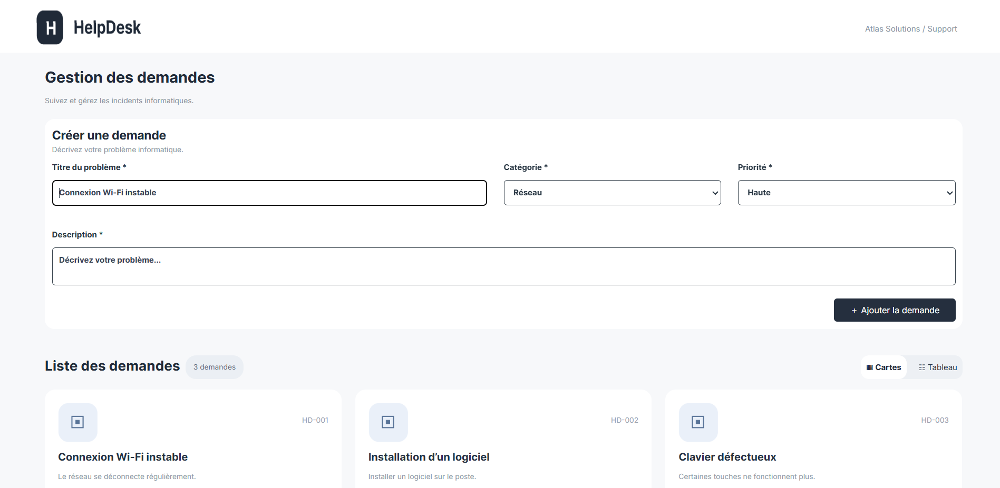

# 🛠️ HelpDesk — Gestion des demandes de support

HelpDesk est une application web interactive permettant de créer, consulter, modifier et supprimer des demandes de support informatique.

Le projet a été réalisé dans le cadre d'un brief pédagogique afin de mettre en pratique **HTML5**, **Tailwind CSS** et **JavaScript Vanilla**, notamment la manipulation du DOM, la gestion des événements, la validation des formulaires et le stockage des données avec `localStorage`.

---

## 🖼️ Aperçu du projet



---

## 📌 Contexte du projet

Atlas Solutions est une entreprise fictive de services numériques qui souhaite centraliser les incidents informatiques signalés par ses collaborateurs.

L'objectif est de développer une interface HelpDesk simple et responsive permettant aux utilisateurs de signaler leurs problèmes informatiques et aux techniciens de consulter et gérer les différentes demandes.

L'application fonctionne entièrement dans le navigateur, sans backend ni base de données.

---

## ✨ Fonctionnalités

### 📝 Gestion des demandes

L'application permet de :

- Ajouter une nouvelle demande
- Afficher les demandes dynamiquement
- Modifier une demande existante
- Supprimer une demande
- Confirmer une suppression avant de l'effectuer
- Afficher le nombre total de demandes
- Générer automatiquement un numéro de ticket unique
- Sauvegarder les demandes dans le navigateur avec `localStorage`
- Basculer entre une vue Cartes et une vue Tableau

Les tickets sont affichés sous la forme :

`HD-001`, `HD-002`, `HD-003`, etc.

---

## 📋 Informations d'une demande

Chaque demande contient :

- Un identifiant unique
- Un titre
- Une description
- Une catégorie
- Une priorité

### Catégories disponibles

- Réseau
- Matériel
- Logiciel

### Priorités disponibles

- Haute
- Normale
- Basse

Chaque niveau de priorité possède un badge visuel différent afin de faciliter son identification.

---

## 🔄 Deux modes d'affichage

L'utilisateur peut basculer entre deux vues différentes sans recharger la page.

### Vue Cartes

Les demandes sont présentées sous forme de cartes contenant :

- Le numéro du ticket
- Le titre
- La description
- La catégorie
- La priorité
- Les actions Modifier et Supprimer

### Vue Tableau

Les mêmes demandes peuvent également être consultées dans un tableau contenant :

- N° Ticket
- Titre de la demande
- Catégorie
- Priorité
- Actions

Le changement entre les deux vues est réalisé dynamiquement avec JavaScript.

---

## 💾 LocalStorage

Les demandes sont sauvegardées dans le `localStorage` du navigateur.

```javascript
localStorage.setItem("demandes", JSON.stringify(lists));
```

Lors du chargement de l'application, les données sauvegardées sont récupérées avec :

```javascript
lists = JSON.parse(localStorage.getItem("demandes"));
```

Cela permet de conserver les demandes même après l'actualisation ou la fermeture de la page.

---

## ✅ Validation du formulaire

Avant l'ajout ou la modification d'une demande, JavaScript vérifie les données saisies.

Le formulaire vérifie notamment :

- Les champs obligatoires
- Les champs vides
- Les valeurs contenant uniquement des espaces
- La longueur du titre
- La longueur de la description

Des messages d'erreur sont affichés lorsque les données saisies ne sont pas valides.

La soumission du formulaire est gérée avec :

```javascript
event.preventDefault();
```

Cela empêche le rechargement automatique de la page lors de la soumission du formulaire.

---

## 🗑️ Suppression d'une demande

Avant de supprimer une demande, une confirmation est demandée à l'utilisateur avec :

```javascript
confirm("Voulez-vous vraiment supprimer cette demande ?");
```

Si l'utilisateur confirme, la demande correspondante est supprimée du tableau et du `localStorage`.

L'affichage et le compteur sont ensuite automatiquement actualisés.

Si l'utilisateur annule, la demande est conservée.

---

## ✏️ Modification d'une demande

L'utilisateur peut modifier une demande existante.

Lorsqu'il clique sur **Modifier** :

1. Une confirmation est demandée.
2. Les informations de la demande sont placées dans le formulaire.
3. L'utilisateur peut modifier les valeurs.
4. La demande correspondante est mise à jour.
5. Les nouvelles données sont sauvegardées dans `localStorage`.
6. L'affichage est automatiquement actualisé.

---

## 📊 Compteur dynamique

L'application affiche automatiquement le nombre total de demandes.

Exemple :

```text
3 demandes
```

Le compteur est actualisé après chaque ajout ou suppression d'une demande.

---

## 📱 Responsive Design

L'interface a été développée pour être utilisable sur différents types d'écrans :

- 📱 Mobile
- 📟 Tablette
- 💻 Desktop

Le responsive design est principalement réalisé avec les classes responsive de Tailwind CSS.

Exemple :

```html
<div class="md:grid md:grid-cols-2 xl:grid-cols-3">
```

Les préfixes `md:` et `xl:` permettent d'adapter l'affichage selon la taille de l'écran.

---

## 🧠 Concepts JavaScript utilisés

Ce projet permet de mettre en pratique plusieurs concepts importants de JavaScript :

- Variables avec `const` et `let`
- Tableaux
- Objets
- Conditions
- Boucles
- Fonctions
- `addEventListener()`
- `preventDefault()`
- `localStorage`
- `JSON.stringify()`
- `JSON.parse()`
- `filter()`
- Manipulation du DOM
- Création dynamique d'éléments
- Modification des classes CSS
- Gestion des formulaires
- Événements `click` et `submit`

---

## 🌳 Manipulation du DOM

Les cartes et les lignes du tableau sont créées dynamiquement avec JavaScript.

Quelques méthodes utilisées :

```javascript
document.createElement()
document.querySelector()
document.getElementById()
append()
classList.add()
classList.remove()
addEventListener()
```

Cela permet d'actualiser l'interface sans recharger la page.

---

## 🛠️ Technologies utilisées

| Technologie | Utilisation |
|---|---|
| HTML5 | Structure de l'application |
| Tailwind CSS | Design et responsive |
| CSS3 | Styles complémentaires |
| JavaScript Vanilla | Logique et interactions |
| DOM API | Manipulation dynamique de l'interface |
| LocalStorage | Sauvegarde locale des demandes |
| Font Awesome | Icônes |
| Google Fonts | Typographie |
| Git | Versionnement |
| GitHub | Hébergement du repository |
| Jira | Gestion des tâches |

---

## 📁 Structure du projet

```text
HelpDesk/
│
├── index.html
│
├── css/
│   └── style.css
│
├── js/
│   └── script.js
│
├── assets/
│   └── images/
│       ├── logo.png
│       ├── card_img.png
│       └── image.png
│
└── README.md
```

---

## 🚀 Installation et lancement

### 1. Cloner le repository

```bash
git clone https://github.com/itsemmax/HelpDesk.git
```

### 2. Accéder au projet

```bash
cd HelpDesk
```

### 3. Lancer l'application

Ouvrir simplement le fichier :

```text
index.html
```

dans un navigateur.

Il est également possible d'utiliser **Live Server** avec Visual Studio Code.

Aucune installation de dépendances, aucun backend et aucune base de données ne sont nécessaires.

---

## 🌿 Organisation Git

Le développement du projet a été organisé avec plusieurs branches afin de séparer les différentes fonctionnalités.

Branches utilisées :

```text
main
develop
feat/lists
feat/mod-del
feat/mod-verif
fix/page
```

Cette organisation permet de développer et tester les fonctionnalités séparément avant leur intégration dans les branches principales.

---

## 📋 Gestion du projet avec Jira

Le projet a été organisé et suivi avec Jira.

Les tâches réalisées sont :

- Initialiser le projet et configurer Tailwind CSS
- Créer la structure de la page HelpDesk
- Créer le formulaire d'ajout d'une demande
- Ajouter la validation du formulaire
- Afficher la liste des demandes sous forme de cartes
- Créer les badges de catégorie et de priorité
- Rendre l'interface responsive avec Tailwind CSS
- Permettre la modification d'une demande
- Permettre la suppression d'une demande
- Ajouter le changement entre les vues Cartes et Tableau
- Afficher les demandes sous forme de tableau
- Tester les fonctionnalités de gestion des demandes

---

## 🎯 Objectifs pédagogiques

Ce projet m'a permis de pratiquer principalement :

- La création d'une interface avec HTML5
- L'utilisation de Tailwind CSS
- Le responsive design
- La manipulation du DOM
- Les événements JavaScript
- La gestion des formulaires
- La validation des données
- La manipulation des tableaux et des objets
- L'ajout, la modification et la suppression de données
- La sauvegarde des données avec `localStorage`
- L'utilisation de Git et GitHub
- L'organisation et le suivi des tâches avec Jira

---
## 🌐 Démo en ligne

🔗 [Voir le site en ligne](https://helpdesk-liart-kappa.vercel.app/)

---

## 👩‍💻 Réalisé par

**Imane Chaoub**

Projet réalisé dans le cadre de la formation **YouCode** — 2026.